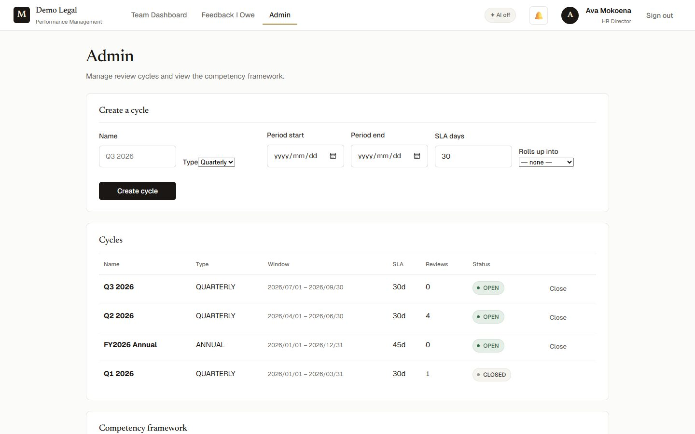
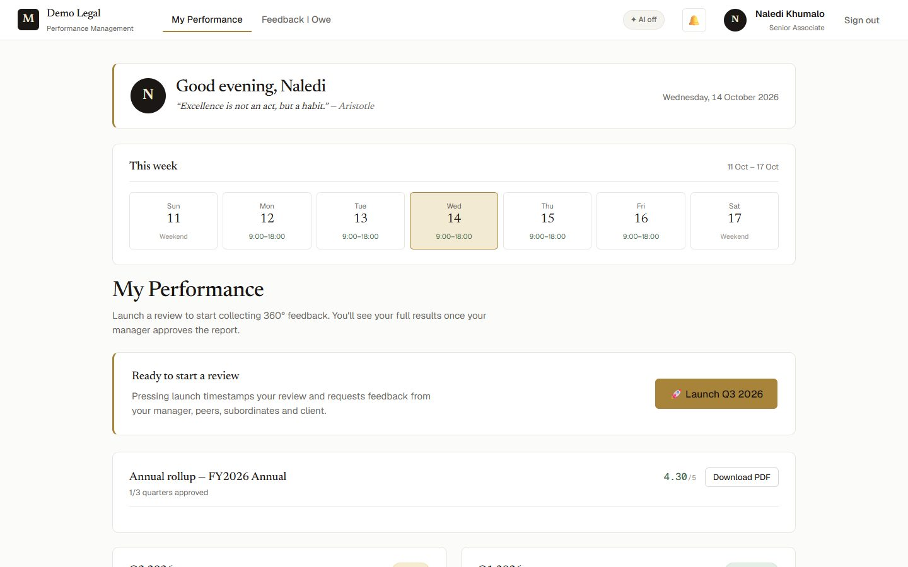
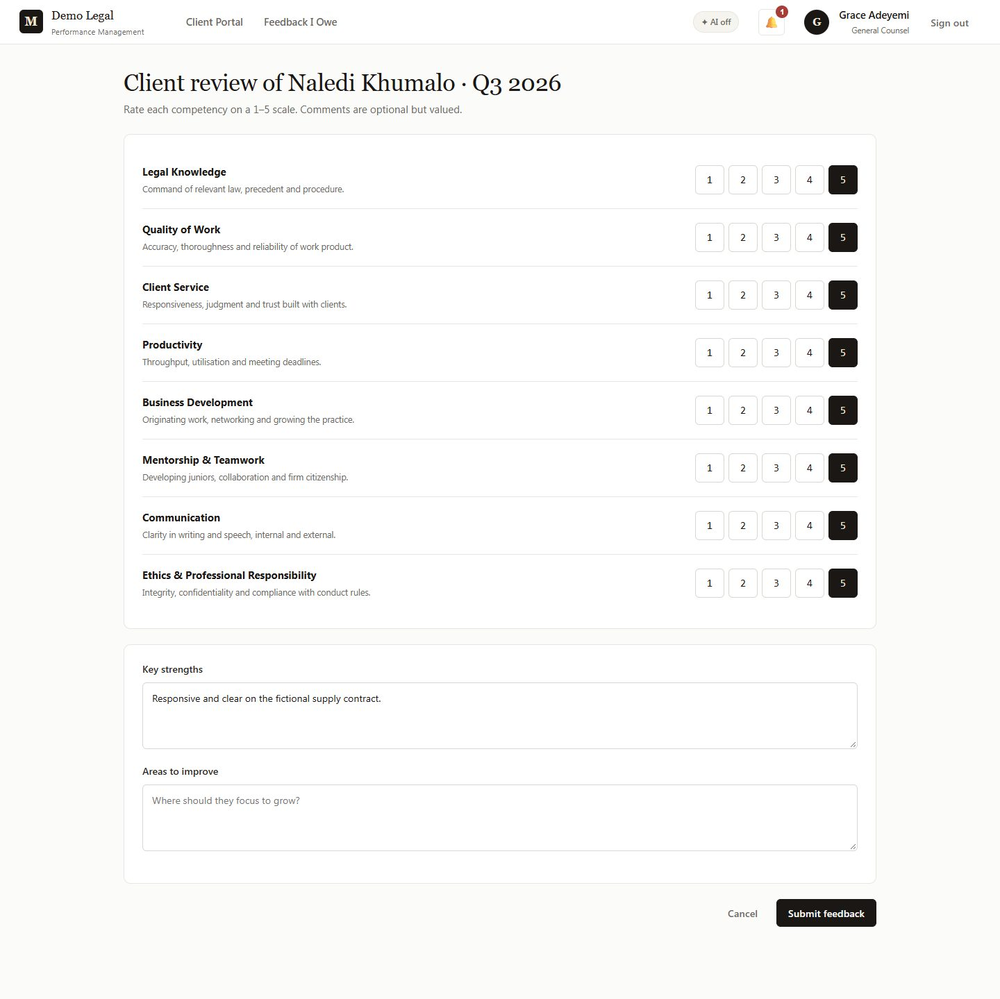
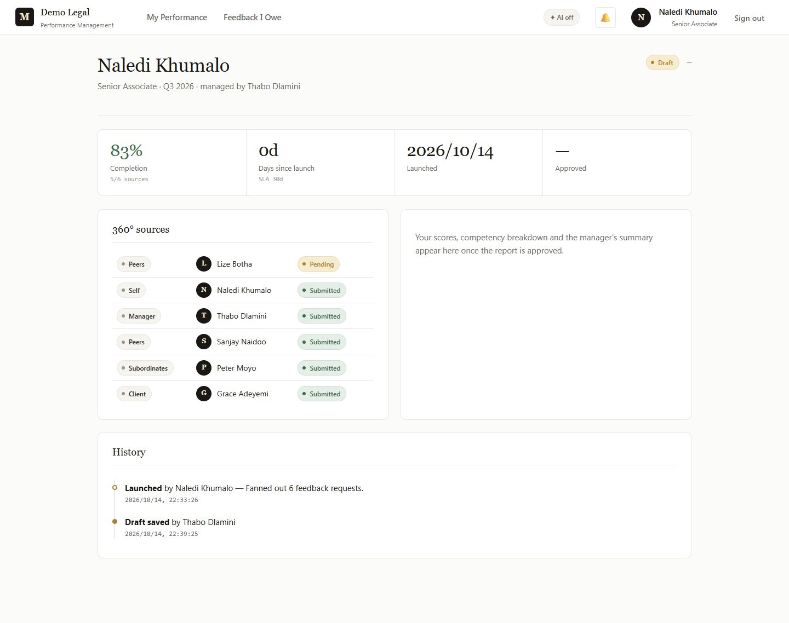
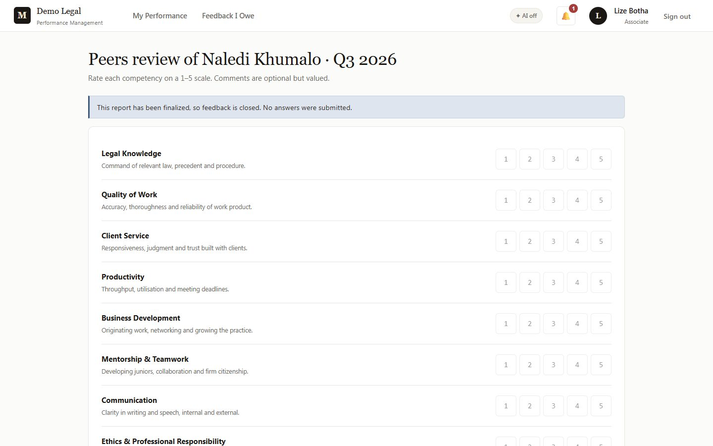
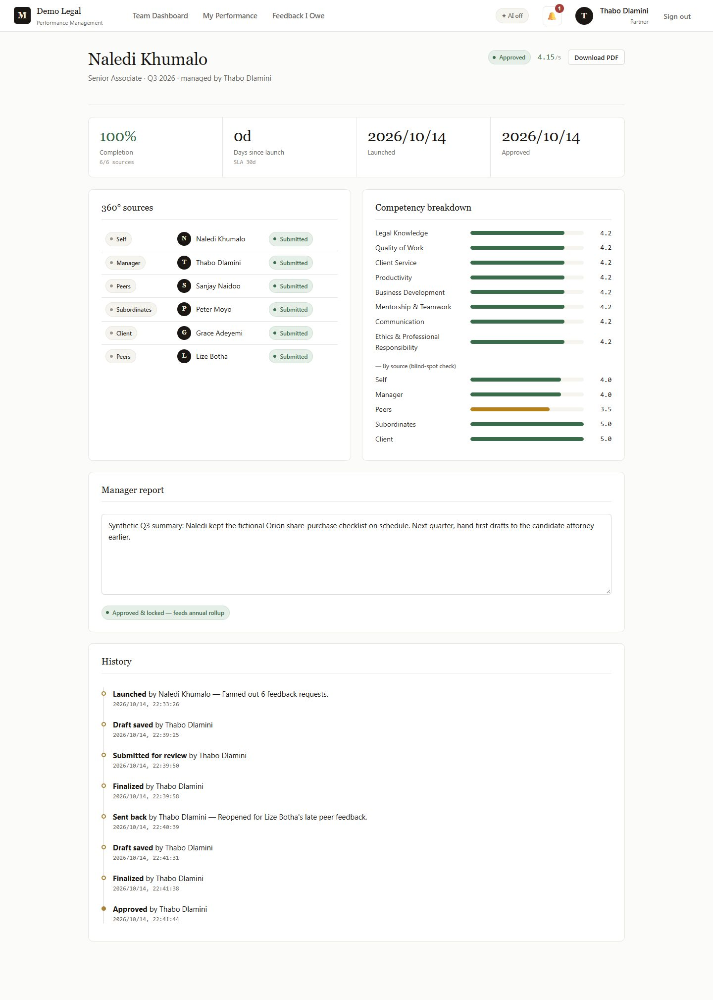
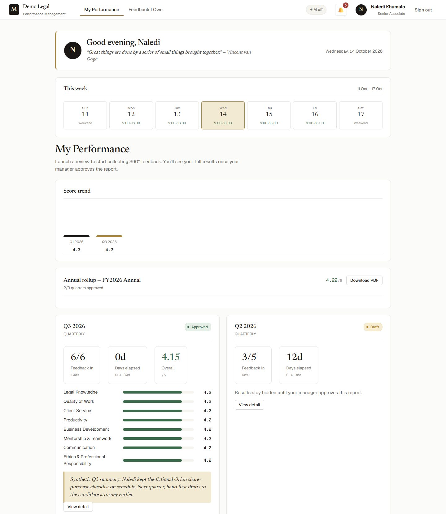
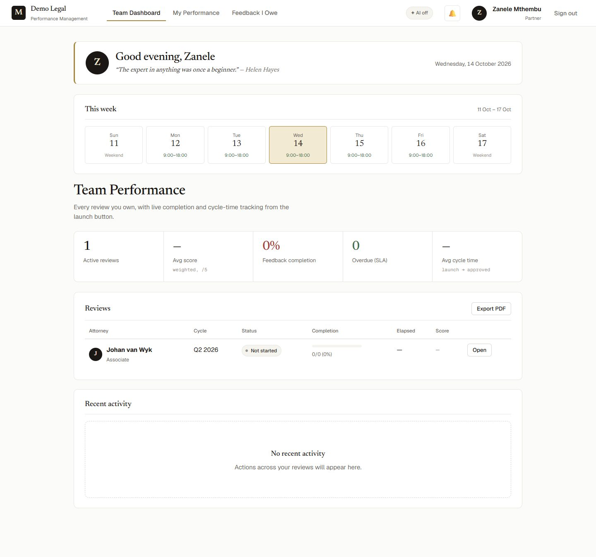
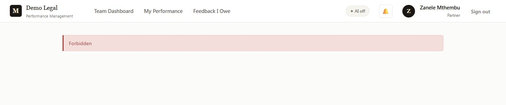

# Synthetic review, feedback and report walkthrough

This runs the actual app — the React SPA, the Express API and PostgreSQL 16 — against a
throwaway database. Every person, firm, matter and address is fictional; all accounts use
`example.test` domains. Nothing here is real performance data.

PMS has no case or matter records. The closest equivalents are the administrator's
review cycle and the attorney's launch, which opens a 360° review and assigns its
reviewers. "Orion" and the "supply contract" below are invented examples written into
feedback text.

## Start a fresh demo

Prerequisites: Node.js 22.12+, npm and a running Docker engine. From the repository root:

```bash
npm --prefix backend ci
npm --prefix frontend ci
node scripts/demo.mjs
```

The launcher:

- starts a `postgres:16-alpine` container bound to `127.0.0.1` on a random port, labelled
  `mostoeneng-pms.disposable-demo=true`, with a generated database password;
- creates the schema and seeds the fictional firm with a generated account password;
- starts the API on `127.0.0.1` with a fresh signing key, `AI_ENABLED=false`, no
  Anthropic key and `EXTERNAL_WIDGETS_ENABLED=false`, overriding the caller's
  environment and any `backend/.env`;
- builds the SPA into a temporary folder and serves it at `http://127.0.0.1:4177`,
  proxying `/api` to the loopback API. Avatars render as local monograms.

It prints the password shared by every seeded account for that run only. It never uses
your `DATABASE_URL` and writes no `.env` file. Each launch starts from a new database.

| Account | Role | Starting data |
|---|---|---|
| `admin@example.test` | Administrator (HR) | All cycles and reviews |
| `t.dlamini@example.test` | Manager, Corporate & Commercial | Owns the team's reviews |
| `n.khumalo@example.test` | Attorney | Q1 approved, Q2 in draft |
| `s.naidoo@example.test` | Attorney | Q2 collecting feedback |
| `l.botha@example.test` | Attorney | Q2 not launched |
| `p.moyo@example.test` | Candidate attorney (reports to Naledi Khumalo) | Subordinate reviewer |
| `client@client.example.test` | Client | Feedback requests only |
| `z.mthembu@example.test` | Manager, Litigation (another team) | Johan van Wyk's review |
| `j.vanwyk@example.test` | Attorney, Litigation | Q2 not launched |

### What is local and what is not

- AI is disabled. The AI buttons are hidden, the top bar shows **AI off**, and the AI
  routes return `{ aiEnabled: false }` without contacting a provider.
- The home widgets show a curated local quote and no weather or holiday markers; the
  server makes no quote, weather or holiday request.
- The browser still loads the Google Fonts stylesheet named in `frontend/index.html`
  (typography only; no account or review data is sent).
- Notifications are in-app rows only. There is no email, Teams or SSO/Microsoft 365
  sign-in, and no hosted deployment.
- The client reviewer is the first active client account. Matching clients to an
  attorney's matters would need matter data that this demo does not have.

## Walk through a quarterly review

1. **The administrator opens a cycle.** Sign in as `admin@example.test`, open **Admin** and
   create `Q3 2026`: Quarterly, 2026-07-01 to 2026-09-30, SLA 30 days, rolling up into
   **FY2026 Annual**. Only administrators can create cycles, and the API rejects blank
   names, invalid or reversed dates, SLAs outside 1–365 days, unknown or quarterly parents,
   an annual cycle with a parent and a duplicate name.

   

2. **The attorney launches the review.** Sign out and sign in as `n.khumalo@example.test`.
   **My Performance** offers **Launch Q3 2026** only: an annual cycle is a rollup of
   approved quarters, not a separate 360. Launch it. Six requests are created: self,
   manager (Thabo Dlamini), the two peers who share Naledi's practice group and manager
   (Lize Botha, Sanjay Naidoo), her direct report (Peter Moyo, asked once, as a
   subordinate) and the client (Grace Adeyemi). Everyone except Naledi receives an in-app
   notification. A manager with no reviewing manager of their own is not offered a launch.

   

3. **Reviewers give feedback.** Sign in as each reviewer, open **Feedback I Owe** (the
   client uses **Client Portal**) and complete the Q3 form. The recorded run used: Naledi
   4s, Thabo 4s, Sanjay 3s, Peter 5s, and the client 4s, then edited to 5s. Reopening a
   submitted form shows the saved answers; resubmitting replaces them. Lize Botha waits.

   

4. **The manager drafts.** Sign in as `t.dlamini@example.test`. The **Team Dashboard**
   shows Naledi's Q3 at 5/6 (83%). **Open** it: the manager sees the live score (4.17/5),
   the competency and by-source breakdowns and every source. Write a draft and **Save
   draft**.

5. **The attorney cannot see mid-cycle results.** As Naledi, open the same review. She sees
   the status, completion, her reviewers and the history, but no score, breakdown, draft
   or summary until approval.

   

6. **Submit and finalize.** As Thabo, **Submit for review**, then **Finalize** with a
   summary. Finalizing locks the narrative and closes feedback.

7. **Late feedback is refused.** As `l.botha@example.test`, open the Q3 form from
   **Feedback I Owe**. It is read-only and says feedback is closed.

   

8. **Send the report back.** As Thabo, enter a reason such as `Reopened for Lize Botha's
   late peer feedback.` and choose **Send back to draft**. The reason goes into the
   history, Naledi is notified, and feedback reopens. As Lize, submit 4s: completion
   reaches 6/6 and the score becomes 4.15.

9. **Re-finalize and approve.** As Thabo, update the draft, **Finalize** with the final
   summary and **Approve (lock)**. The approved report cannot be edited, sent back or
   given more feedback. Its history lists all eight events in order.

   

10. **The attorney reads the approved report.** As Naledi, **My Performance** now shows Q3
    approved at 4.15 with its breakdown and summary. The FY2026 rollup counts two of three
    quarters (Q1 at 4.30 and Q3 at 4.15) and shows 4.22. Reloading keeps the same state.

    

11. **Another team stays out.** Sign in as `z.mthembu@example.test`. Her **Team Dashboard**
    lists only Johan van Wyk. Opening the address of Naledi's review shows *Forbidden*.

    

    

## Run the automatic checks

```bash
npm --prefix backend run test:workflow
node scripts/demo.mjs --check
```

`test:workflow` starts its own container and the real API process, then signs in over HTTP
as all nine accounts. It reports 26 results (25 checks plus the parent). They cover:

- caller isolation (a production-like `DATABASE_URL`, `NODE_ENV`, signing key and AI key
  are ignored), wrong passwords, malformed bodies, missing and forged tokens;
- AI and external widgets switched off;
- cycle creation by role and every validation listed in step 1;
- quarterly-only launch, the reviewing-manager requirement and one request per source;
- notifications for reviewers only, and feedback validation that leaves no partial
  answers behind;
- the attorney's hidden mid-cycle results, the reviewer skeleton and the cross-team
  denials, including the annual rollup;
- drafts and transitions on unlaunched reviews, the finalization lock, send-back with
  its reason, approval immutability and the exact event order;
- the approved report, scores, trend and rollup as the attorney sees them;
- the AI routes' disabled contract, and persistence across an API restart.

`--check` builds the SPA, serves it through the same proxy, signs in and reads seeded data,
then removes the container and build output. GitHub Actions runs both on Ubuntu with
Docker, alongside the existing authentication, directory and build checks.

## Stop and repeat

Press **Ctrl+C** in the launcher terminal. It stops the preview server and the API,
removes its database container and deletes the temporary build. Starting again resets the
demonstration; no volume is kept. A forced kill can bypass this cleanup. If that happens,
list the leftovers with
`docker ps -a --filter label=mostoeneng-pms.disposable-demo=true` and remove only those
`mostoeneng-pms-demo-…` containers.

## Recorded evidence

Recorded on 14 October 2026 on Windows 11 with Node.js 26.8.1, Docker 29.7 and the
PostgreSQL 16 container. Each step above was carried out through the browser UI, one
account at a time, in the Claude desktop app's in-app browser, ending with a page reload of
the approved review. The images were captured with headless Microsoft Edge at each step;
image 05 was retaken on a fresh demo, replayed to the same finalized state through the HTTP
API, after the read-only rating style was added. All screenshots contain fictional data
only.

This demonstrates one quarterly workflow and selected authorization boundaries. It does not
establish a hosted deployment, SSO or Microsoft 365 integration, email or Teams delivery,
live AI output, the contents of generated PDFs (the **Download PDF** button appears after
approval but was not opened in this run), multi-office tenancy, or POPIA retention
controls. Seeded Q1 ratings vary slightly between seeds while its stored overall score is
fixed at 4.30; the new Q3 scores are deterministic.
